<div align="center">

# Bare-metal peripheral drivers for the STM32F411CEU6

**English** | [Русский](README.ru.md)

**C · Cortex-M4 · SPI · I2C · USART · GPIO**

[Browse the examples](#hardware-captures) &nbsp; / &nbsp; [Build](#try-it) &nbsp; / &nbsp; [How it works](#under-the-hood)

</div>

This project contains peripheral drivers for the STM32F411 and small tests of those drivers. Everything was written without HAL/LL. LLMs were used only to explain less obvious points; most of the work was done with documentation (RM, PM, schematic, User Guide) to better understand how things work.

The drivers access peripheral registers directly, and the repository includes captures of an STM32F411 board communicating with an ESP32 over SPI, I2C and USART.

## Hardware captures

All examples are in collapsible sections, with screenshots showing the drivers in operation.

### GPIO · pins and interrupts

Three small starting points: toggle an LED, control it with a key, and handle a key press through EXTI. Source code is available for each example.

- [LED toggle](Src/examples/gpio/ledtoggle/ledtoggle.c)
- [Key controls LED](Src/examples/gpio/keyledtoggle/keyledtoggle.c)
- [Key interrupt](Src/examples/gpio/keyinterrupt/keyinterrupt.c)

### SPI · 4 experiments

<details>
<summary><strong>1 · Blocking transmit to a logic analyzer</strong></summary>

SPI2 sends a byte string with `SPI_SendData`.

Source: [`spi_tx_test.c`](Src/examples/spi/spi_tx_logic_test/spi_tx_test.c) · [Notes](Src/examples/spi/spi_tx_logic_test/README.md)

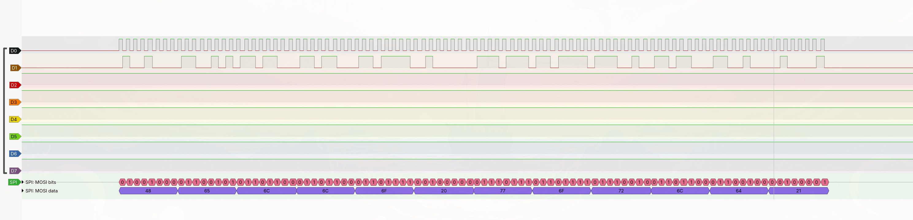

</details>

<details>
<summary><strong>2 · STM32 sends a message to ESP32</strong></summary>

The STM32 sends a length byte and a message. The ESP32 prints the received text.

Source: [`spi_esp_communication.c`](Src/examples/spi/spi_esp_tx_test/spi_esp_communication.c) · [Notes](Src/examples/spi/spi_esp_tx_test/README.md)

| On the bus | At the ESP32 |
|---|---|
| 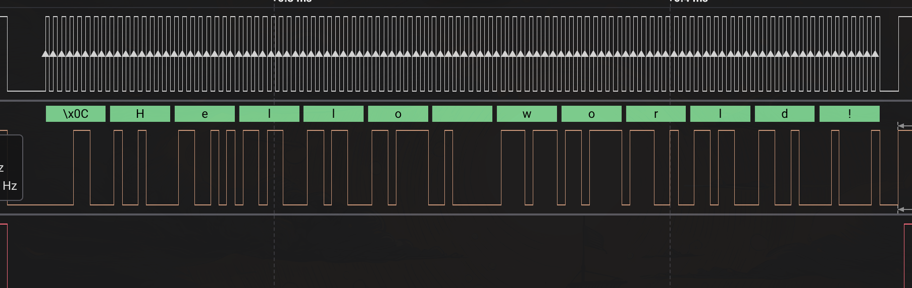 | 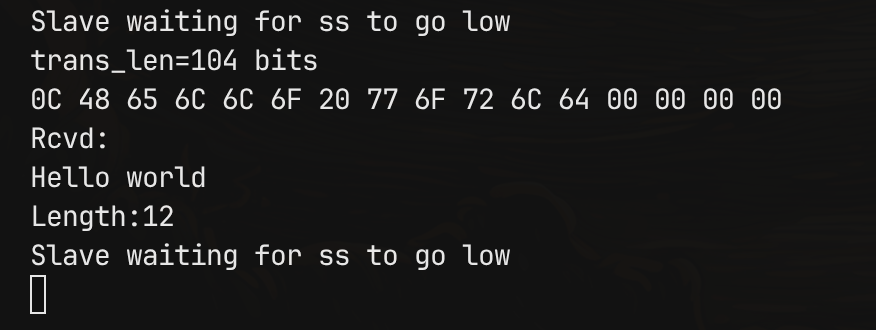 |

</details>

<details>
<summary><strong>3 · ESP32 sends a message to STM32</strong></summary>

The ESP32 sends `Hello world!`; the STM32 receives the bytes into a buffer.

Source: [`spi_esp_tx_rx_test.c`](Src/examples/spi/spi_esp_rx_test/spi_esp_tx_rx_test.c) · [Notes](Src/examples/spi/spi_esp_rx_test/README.md)

| On the bus | In the debugger |
|---|---|
| 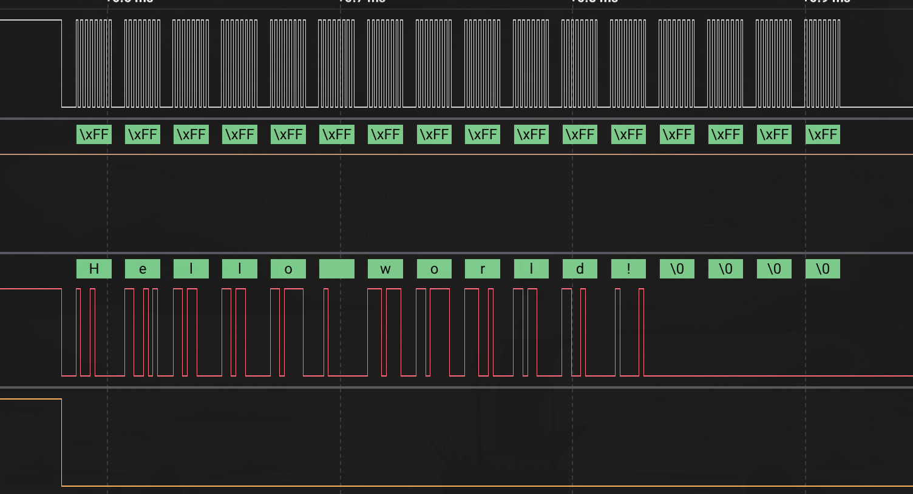 | 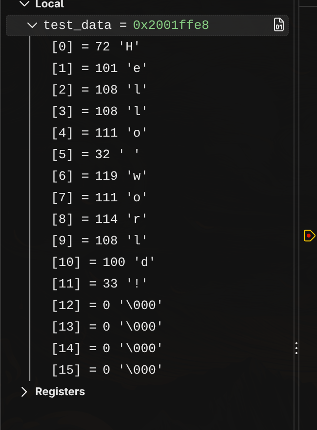 |

</details>

<details>
<summary><strong>4 · Interrupt-driven SPI transfer</strong></summary>

An example of the SPI interrupt API. The receive example has not been implemented yet.

Source: [`spi_esp_tx_test.c`](Src/examples/spi/spi_tx_rx_interrupt_test/spi_esp_tx_test.c) · [Notes](Src/examples/spi/spi_tx_rx_interrupt_test/README.md)

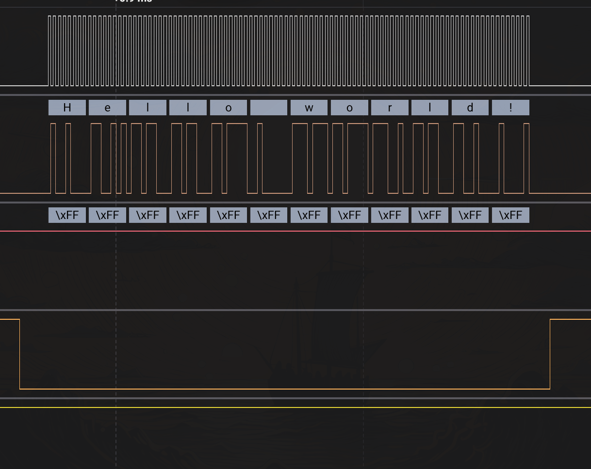

</details>

### I2C · 4 experiments

All four examples use I2C1 on PB6 (SCL) and PB7 (SDA), with an ESP32 as the peer. Both bus lines need pull-up resistors.

<details>
<summary><strong>1 · STM32 → ESP32, polling transmit</strong></summary>

Pressing the key starts a blocking master write.

Source: [`i2c_tx_key_test.c`](Src/examples/i2c/i2c_tx_key_test/i2c_tx_key_test.c) · [Notes](Src/examples/i2c/i2c_tx_key_test/README.md)

| Logic analyzer | Received by ESP32 |
|---|---|
| 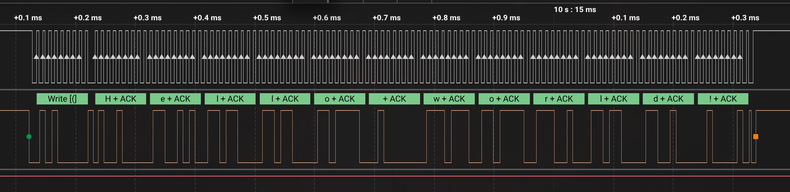 | 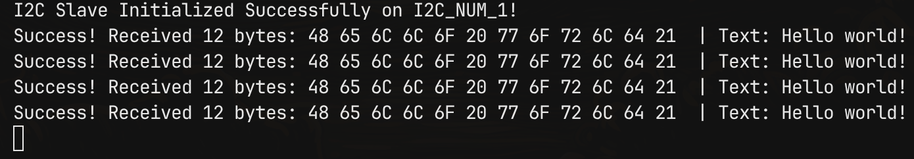 |

</details>

<details>
<summary><strong>2 · STM32 → ESP32, interrupt transmit</strong></summary>

The same key-triggered write, using I2C interrupts.

Source: [`i2c_tx_key_test_interrupt.c`](Src/examples/i2c/i2c_tx_key_test_interrupt/i2c_tx_key_test_interrupt.c) · [Notes](Src/examples/i2c/i2c_tx_key_test_interrupt/README.md)

| Logic analyzer | Received by ESP32 |
|---|---|
| 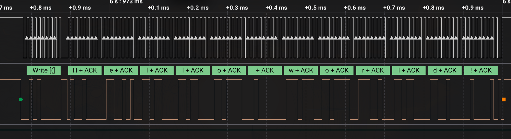 | 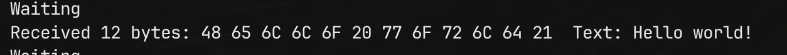 |

</details>

<details>
<summary><strong>3 · ESP32 → STM32, polling receive</strong></summary>

Pressing the key starts a blocking master read; the received data is shown in the debugger.

Source: [`i2c_rx_key_test.c`](Src/examples/i2c/i2c_rx_key_test/i2c_rx_key_test.c) · [Notes](Src/examples/i2c/i2c_rx_key_test/README.md)

| Logic analyzer | Received data |
|---|---|
| 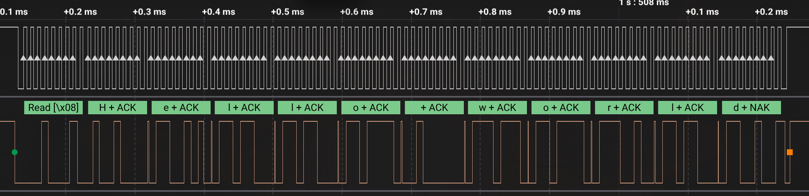 | 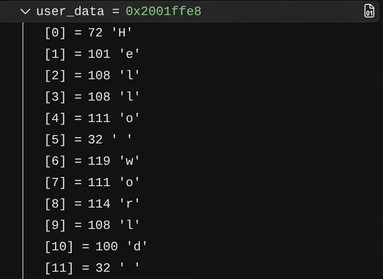 |

</details>

<details>
<summary><strong>4 · ESP32 → STM32, interrupt receive</strong></summary>

The same master read, using I2C interrupts.

Source: [`i2c_rx_key_test_interrupt.c`](Src/examples/i2c/i2c_rx_key_test_interrupt/i2c_rx_key_test_interrupt.c) · [Notes](Src/examples/i2c/i2c_rx_key_test_interrupt/README.md)

| Logic analyzer | Received data |
|---|---|
| 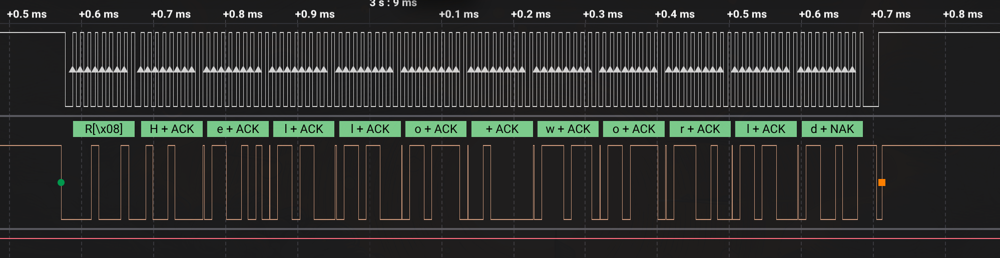 | 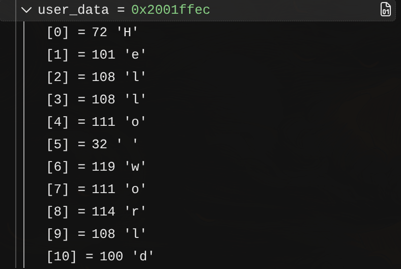 |

</details>

### USART · 3 experiments

The examples use USART1 on PB6 (TX) and PB7 (RX), at 115200 baud in 8N1 format.

<details>
<summary><strong>1 · STM32 sends text to ESP32</strong></summary>

Pressing the key starts the transmission.

Source: [`usart_tx_key_test.c`](Src/examples/usart/usart_tx_key_test/usart_tx_key_test.c) · [Notes](Src/examples/usart/usart_tx_key_test/README.md)

| Logic analyzer | Received text |
|---|---|
| 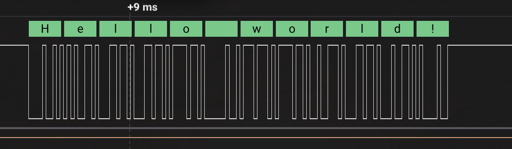 | 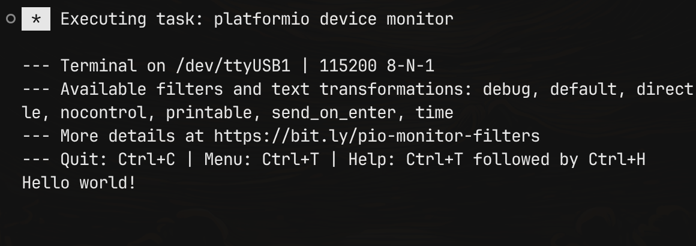 |

</details>

<details>
<summary><strong>2 · USART echo</strong></summary>

Blocking send and receive between STM32 and ESP32.

Source: [`usart_tx_rx_key_test.c`](Src/examples/usart/usart_tx_rx_key_test/usart_tx_rx_key_test.c) · [Notes](Src/examples/usart/usart_tx_rx_key_test/README.md)

| Logic analyzer | Debugger state |
|---|---|
| 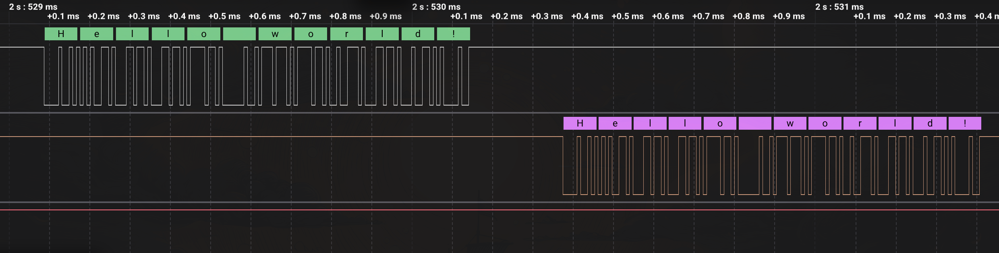 | 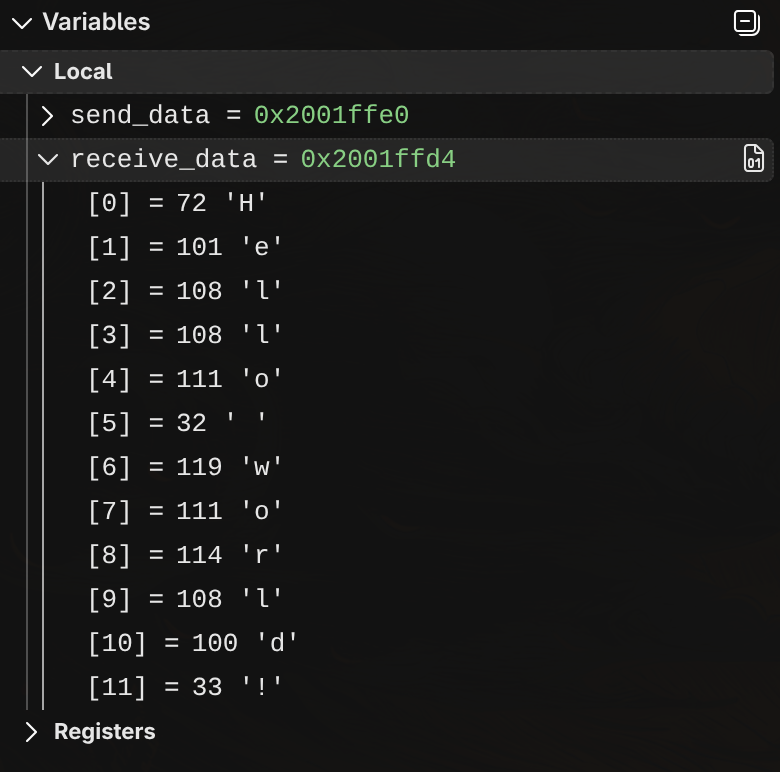 |

</details>

<details>
<summary><strong>3 · USART echo with interrupts</strong></summary>

The echo exchange using USART interrupts.

Source: [`usart_tx_rx_key_interrupts_test.c`](Src/examples/usart/usart_tx_rx_key_interrupts_test/usart_tx_rx_key_interrupts_test.c) · [Notes](Src/examples/usart/usart_tx_rx_key_interrupts_test/README.md)

| Logic analyzer | Debugger state |
|---|---|
| 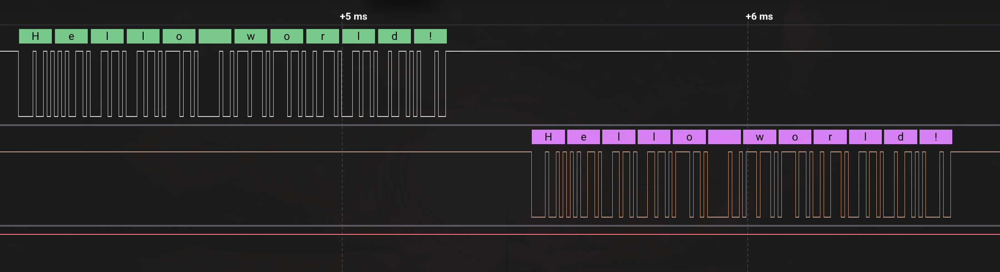 | 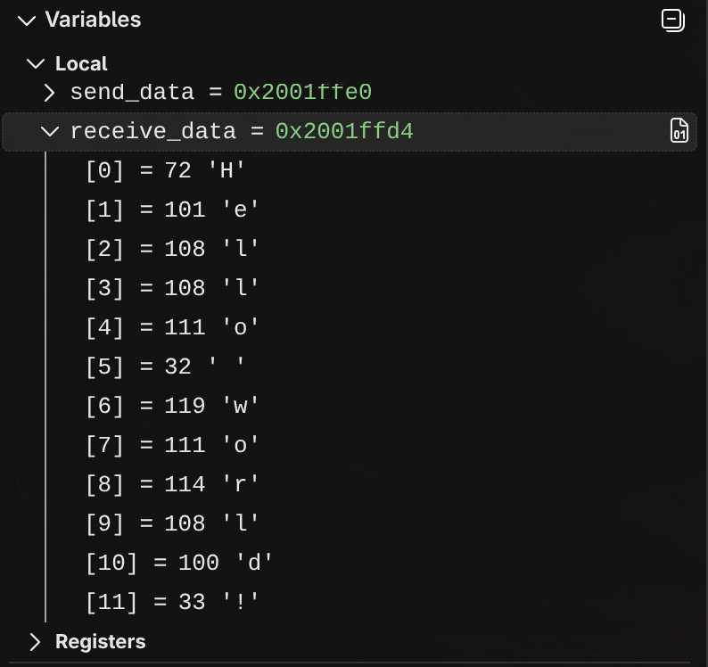 |

</details>

## Under the hood

The drivers have a similar structure: configure the peripheral, initialize it, then choose a blocking or interrupt-driven data path.

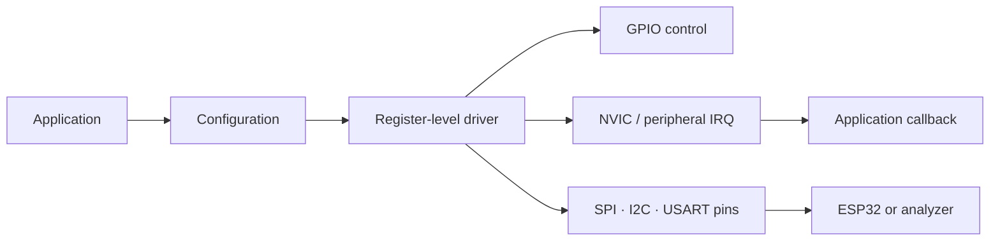

Some details matter when using the code:

- `*_Init` enables the peripheral clock. SPI and USART also need their **peripheral control** function to set the enable bit; I2C initialization enables the peripheral itself.
- Application interrupt handlers forward to the matching `*_IRQHandling` function. Weak callbacks are provided for driver events.
- RCC clock values are used when calculating USART baud rate and I2C timing.
- Register structures, addresses and bit definitions are in `drivers/Inc/stm32f411xx.h`.

## Try it

Install CMake 3.20 or later and `arm-none-eabi-gcc`, then run:

```sh
cmake --preset Debug
cmake --build --preset Debug
```

The ELF is written to `build/Debug/drivers.elf`. Examples and tests are in `Src/examples`.

The examples have been tested only on the STM32F411CEU6. They are firmware tests. Pin assignments and peer firmware are documented in the example folders.

## Limitations

This is a learning project, and there are a few limitations in the current code:

- Blocking calls have no timeout and can wait indefinitely for a hardware flag or an ACK.
- Most APIs return `void`; error handling and argument validation are limited.
- DMA is not implemented.
- RCC does not account for PLL as the active system clock source; the HSE frequency is set at compile time for the board.
- I2C supports 7-bit addressing and needs pull-up resistors.

## Author

[@Steep-rwx](https://github.com/Steep-rwx)
