<div align="center">

# Драйверы периферии без HAL для STM32F411CEU6

[English](README.md) | **Русский**

**C · Cortex-M4 · SPI · I2C · USART · GPIO**

[Посмотреть примеры](#проверка-по-сигналам) &nbsp; / &nbsp; [Сборка](#попробовать) &nbsp; / &nbsp; [Об устройстве](#как-это-устроено)

</div>

В этом проекте собраны драйверы для STM32F411 и небольшие тесты этих драйверов. Всё было написано без HAL/LL, а также LLM использовалась только в качестве объяснения неочевидных моментов, в основном всё писалось при помощи документации (RM, PM, schematic, User Guide) для лучшего понимания процессов.

Драйверы напрямую обращаются к регистрам периферии, а в репозитории есть захваты обмена платы STM32F411 с ESP32 по SPI, I2C и USART.

## Проверка по сигналам

Все примеры находятся в свёрнутых пунктах, также предоставлены различные скриншоты доказательства работы драйверов

### GPIO · выводы и прерывания

Три небольших примера для начала: переключение светодиода, управление им кнопкой и обработка нажатия кнопки через EXTI. Исходный код доступен для каждого примера;

- [Переключение светодиода](Src/examples/gpio/ledtoggle/ledtoggle.c)
- [Кнопка управляет светодиодом](Src/examples/gpio/keyledtoggle/keyledtoggle.c)
- [Прерывание от кнопки](Src/examples/gpio/keyinterrupt/keyinterrupt.c)

### SPI · 4 эксперимента

<details>
<summary><strong>1 · Передача без прерываний на логический анализатор</strong></summary>

SPI2 отправляет строку байтов с помощью `SPI_SendData`.

Исходный код: [`spi_tx_test.c`](Src/examples/spi/spi_tx_logic_test/spi_tx_test.c) · [Описание](Src/examples/spi/spi_tx_logic_test/README.md)

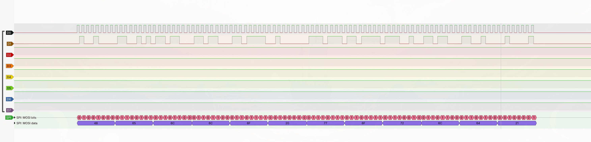

</details>

<details>
<summary><strong>2 · STM32 отправляет сообщение на ESP32</strong></summary>

STM32 отправляет байт длины и сообщение. ESP32 выводит полученный текст.

Исходный код: [`spi_esp_communication.c`](Src/examples/spi/spi_esp_tx_test/spi_esp_communication.c) · [Описание](Src/examples/spi/spi_esp_tx_test/README.md)

| На шине | На ESP32 |
|---|---|
| 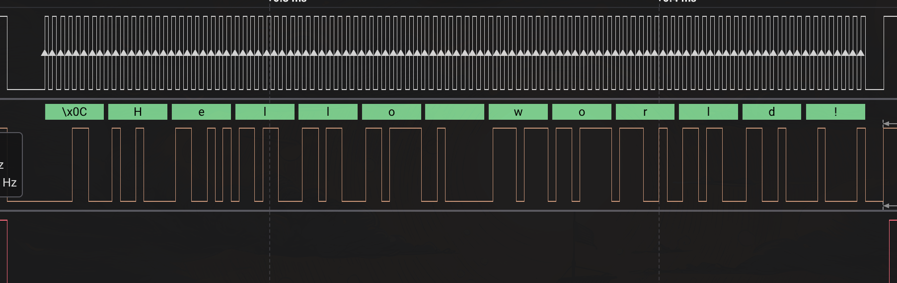 | 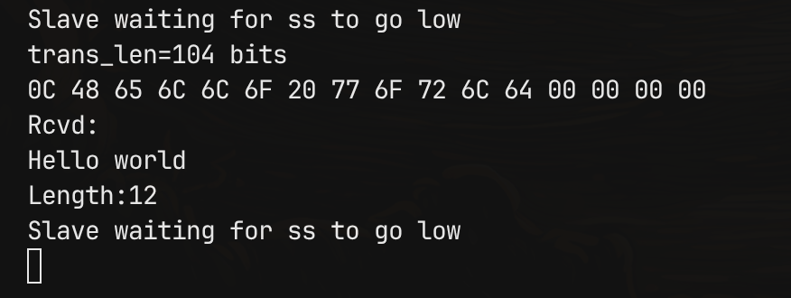 |

</details>

<details>
<summary><strong>3 · ESP32 отправляет сообщение на STM32</strong></summary>

ESP32 отправляет `Hello world!`; STM32 принимает байты в буфер.

Исходный код: [`spi_esp_tx_rx_test.c`](Src/examples/spi/spi_esp_rx_test/spi_esp_tx_rx_test.c) · [Описание](Src/examples/spi/spi_esp_rx_test/README.md)

| На шине | В отладчике |
|---|---|
| 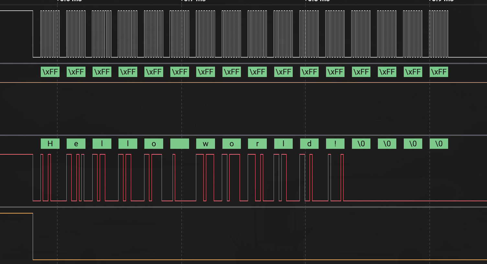 | 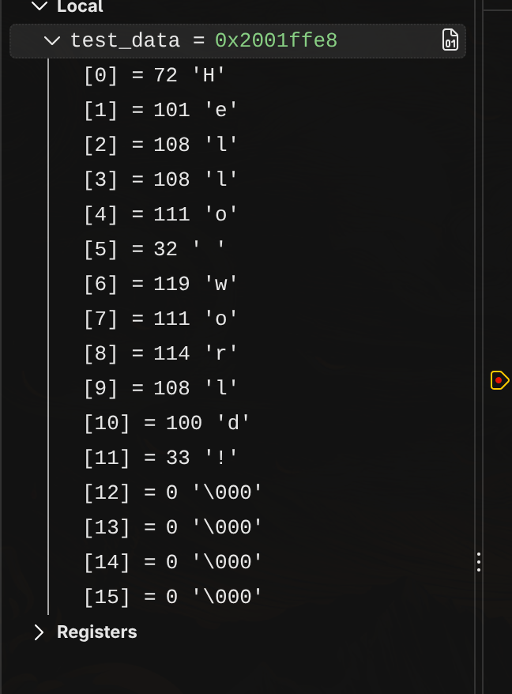 |

</details>

<details>
<summary><strong>4 · Передача SPI через прерывания</strong></summary>

Пример API прерываний SPI. Пример с приёмом данных пока не реализован;

Исходный код: [`spi_esp_tx_test.c`](Src/examples/spi/spi_tx_rx_interrupt_test/spi_esp_tx_test.c) · [Описание](Src/examples/spi/spi_tx_rx_interrupt_test/README.md)

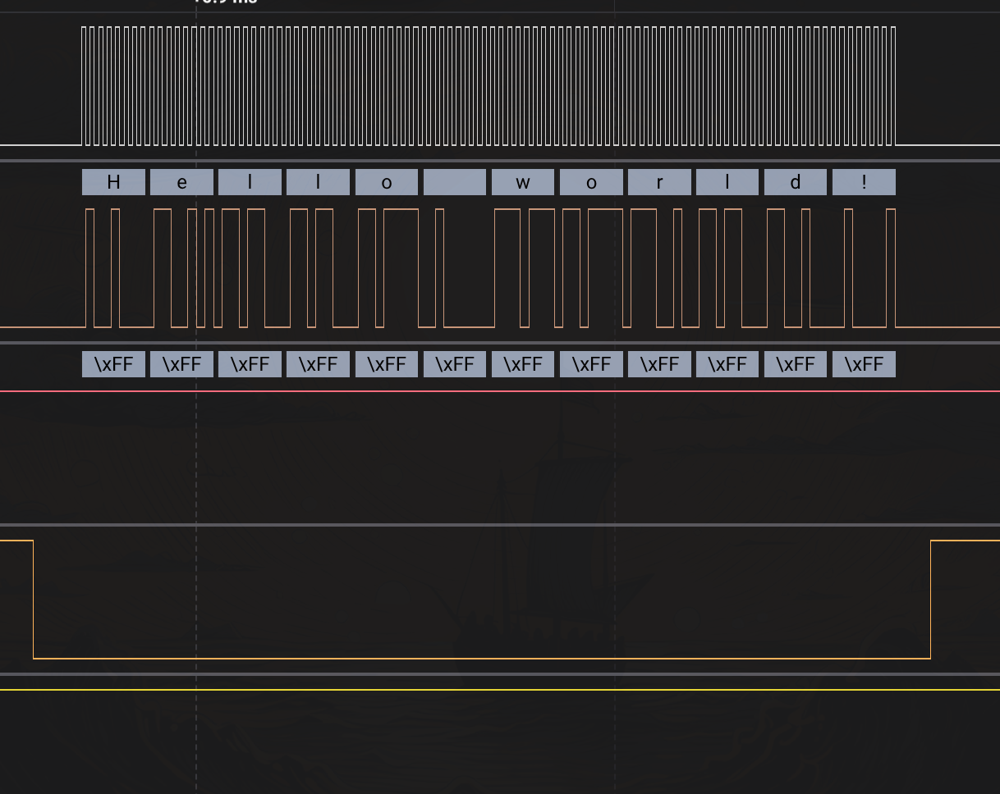

</details>

### I2C · 4 эксперимента

Во всех четырёх примерах используется I2C1 на PB6 (SCL) и PB7 (SDA), а в качестве второго устройства — ESP32. Для обеих линий шины нужны Pull-Up резисторы.

<details>
<summary><strong>1 · STM32 → ESP32, передача с опросом флагов</strong></summary>

Нажатие кнопки запускает блокирующую отправку данных мастером.

Исходный код: [`i2c_tx_key_test.c`](Src/examples/i2c/i2c_tx_key_test/i2c_tx_key_test.c) · [Описание](Src/examples/i2c/i2c_tx_key_test/README.md)

| Логический анализатор | Получено ESP32 |
|---|---|
| 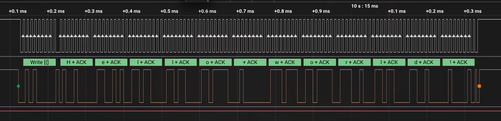 | 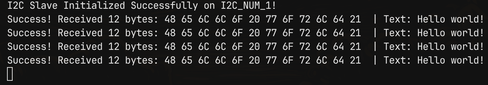 |

</details>

<details>
<summary><strong>2 · STM32 → ESP32, передача через прерывания</strong></summary>

Та же отправка по нажатию кнопки, но с прерываниями I2C.

Исходный код: [`i2c_tx_key_test_interrupt.c`](Src/examples/i2c/i2c_tx_key_test_interrupt/i2c_tx_key_test_interrupt.c) · [Описание](Src/examples/i2c/i2c_tx_key_test_interrupt/README.md)

| Логический анализатор | Получено ESP32 |
|---|---|
| 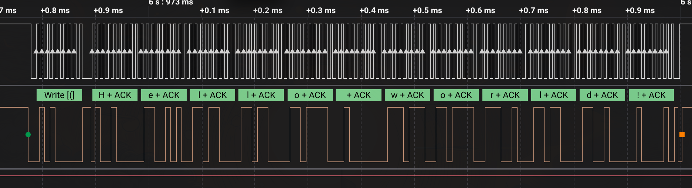 | 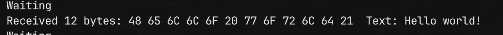 |

</details>

<details>
<summary><strong>3 · ESP32 → STM32, приём с опросом флагов</strong></summary>

Нажатие кнопки запускает блокирующий приём мастером; полученные данные показаны в отладчике.

Исходный код: [`i2c_rx_key_test.c`](Src/examples/i2c/i2c_rx_key_test/i2c_rx_key_test.c) · [Описание](Src/examples/i2c/i2c_rx_key_test/README.md)

| Логический анализатор | Полученные данные |
|---|---|
| 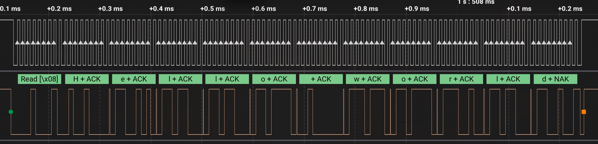 | 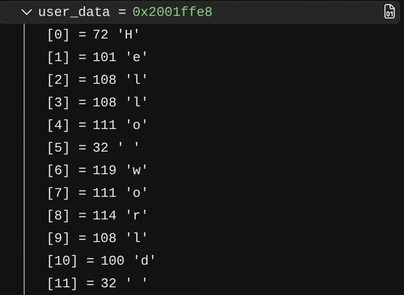 |

</details>

<details>
<summary><strong>4 · ESP32 → STM32, приём через прерывания</strong></summary>

Тот же приём мастером, но с прерываниями I2C.

Исходный код: [`i2c_rx_key_test_interrupt.c`](Src/examples/i2c/i2c_rx_key_test_interrupt/i2c_rx_key_test_interrupt.c) · [Описание](Src/examples/i2c/i2c_rx_key_test_interrupt/README.md)

| Логический анализатор | Полученные данные |
|---|---|
| 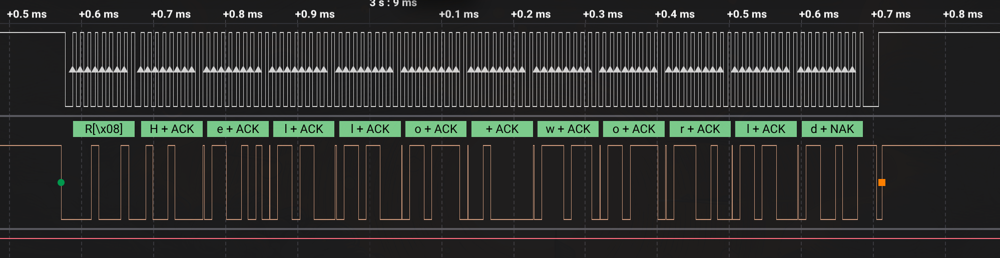 | 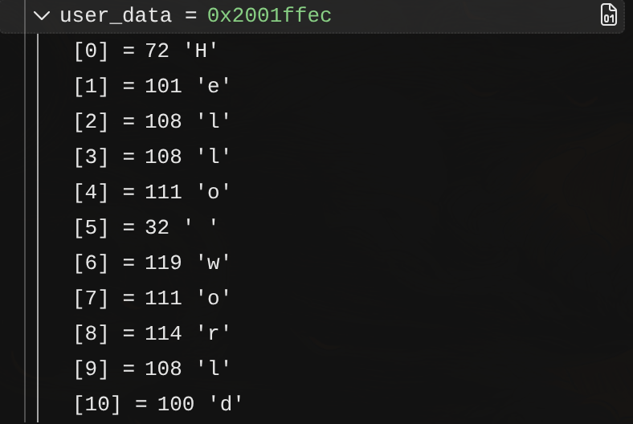 |

</details>

### USART · 3 эксперимента

В примерах используется USART1 на PB6 (TX) и PB7 (RX), скорость — 115200, формат — 8N1.

<details>
<summary><strong>1 · STM32 отправляет текст на ESP32</strong></summary>

Нажатие кнопки запускает передачу.

Исходный код: [`usart_tx_key_test.c`](Src/examples/usart/usart_tx_key_test/usart_tx_key_test.c) · [Описание](Src/examples/usart/usart_tx_key_test/README.md)

| Логический анализатор | Полученный текст |
|---|---|
| 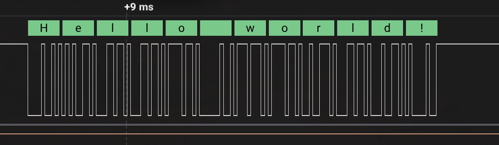 | 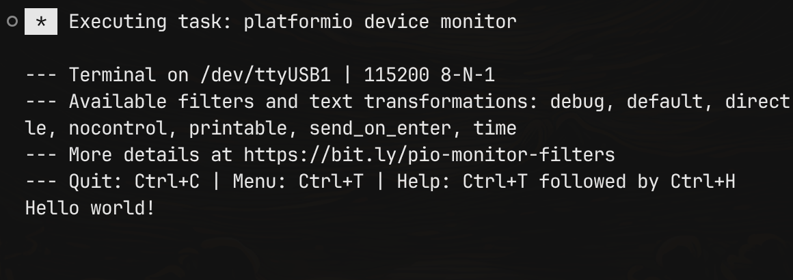 |

</details>

<details>
<summary><strong>2 · Эхо USART</strong></summary>

Блокирующие передача и приём между STM32 и ESP32.

Исходный код: [`usart_tx_rx_key_test.c`](Src/examples/usart/usart_tx_rx_key_test/usart_tx_rx_key_test.c) · [Описание](Src/examples/usart/usart_tx_rx_key_test/README.md)

| Логический анализатор | Состояние отладчика |
|---|---|
| 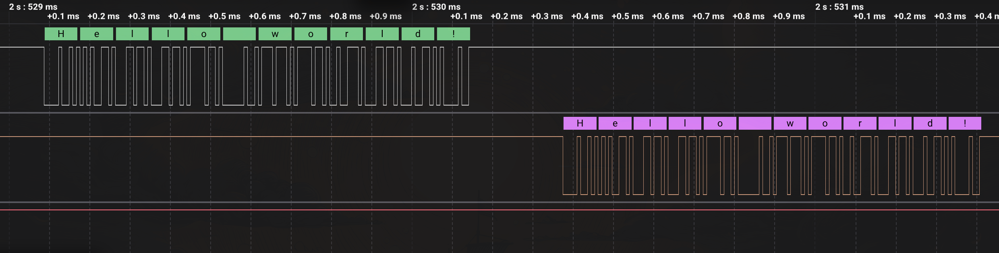 | 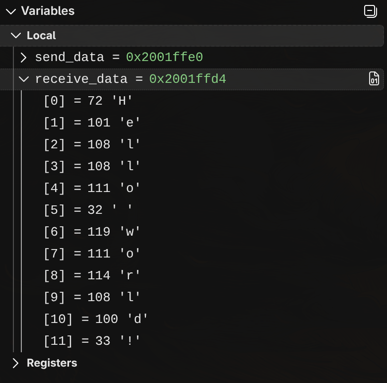 |

</details>

<details>
<summary><strong>3 · Эхо USART через прерывания</strong></summary>

Обмен в режиме эхо с использованием прерываний USART.

Исходный код: [`usart_tx_rx_key_interrupts_test.c`](Src/examples/usart/usart_tx_rx_key_interrupts_test/usart_tx_rx_key_interrupts_test.c) · [Описание](Src/examples/usart/usart_tx_rx_key_interrupts_test/README.md)

| Логический анализатор | Состояние отладчика |
|---|---|
| 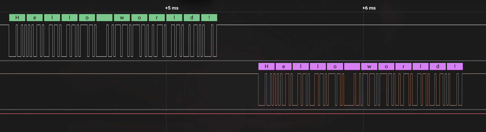 | 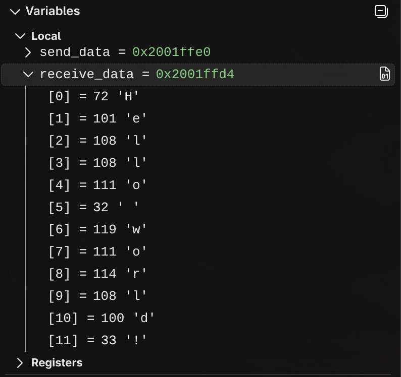 |

</details>

## Как это устроено

Структура у драйверов похожая: настроить конфигурацию, инициализировать периферию, затем выбрать блокирующий путь обмена данными или путь через прерывания.

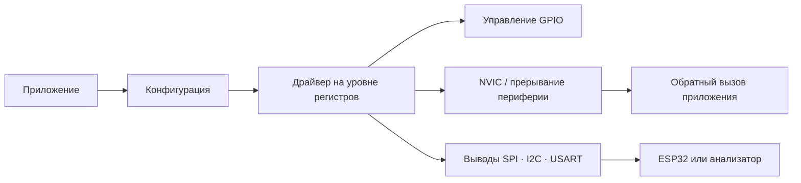

При использовании кода важно учитывать несколько деталей:

- `*_Init` включает тактирование периферии. Для SPI и USART также нужна функция **управления периферией**, устанавливающая бит включения; инициализация I2C включает саму периферию.
- Обработчики прерываний приложения передают управление соответствующей функции `*_IRQHandling`. Для событий драйверов предусмотрены weak обратные вызовы приложения.
- Значения частоты RCC используются при расчёте скорости USART и временных параметров I2C.
- Структуры регистров, адреса и определения битов находятся в `drivers/Inc/stm32f411xx.h`.

## Попробовать

Установите CMake версии 3.20 или новее и `arm-none-eabi-gcc`, затем выполните:

```sh
cmake --preset Debug
cmake --build --preset Debug
```

Файл ELF будет создан по пути `build/Debug/drivers.elf`. Примеры и тесты находятся в `Src/examples`.

Примеры из examples тестировались только на STM32F411CEU6. Примеры служат физическими тестами прошивки. Назначения выводов и прошивка второго устройства описаны в папках примеров.

## Ограничения

Это учебный проект, и в текущем коде есть несколько ограничений:

- У блокирующих вызовов нет тайм-аута: они могут ждать аппаратный флаг или подтверждение ACK бесконечно.
- Большинство API возвращает `void`; обработка ошибок и проверка аргументов ограничены.
- DMA не реализован.
- RCC не учитывает PLL в качестве активного источника системной частоты; частота HSE задаётся при компиляции для платы.
- I2C поддерживает 7-битную адресацию и требует Pull-Up резисторов.

## Автор

[@Steep-rwx](https://github.com/Steep-rwx)
