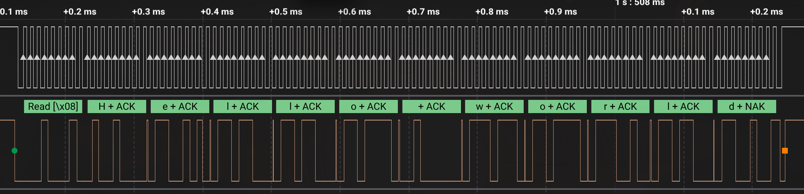
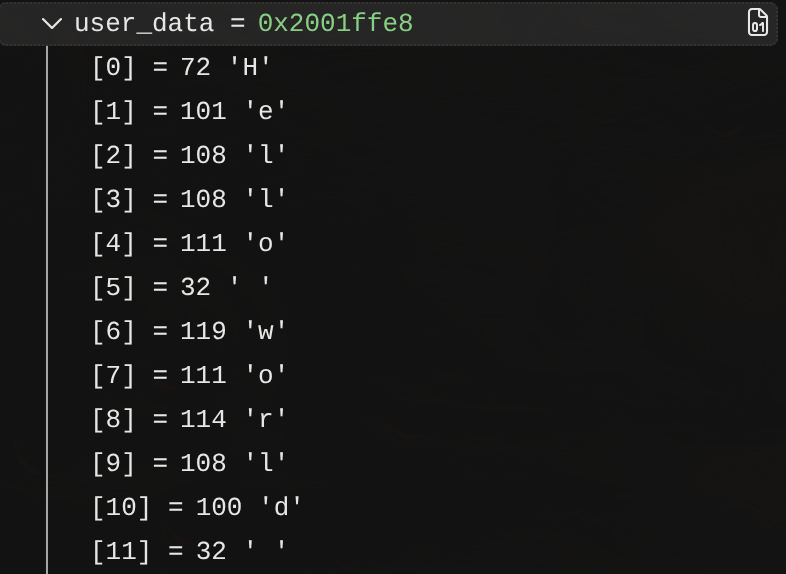

# ESP32 to STM32 by I2C receive

В данном примере было реализовано получение при помощи драйвера данных через I2C от STM32 к ESP32.

---
## Tests:
Из логического анализатора:

Из ST-Link debugger:
