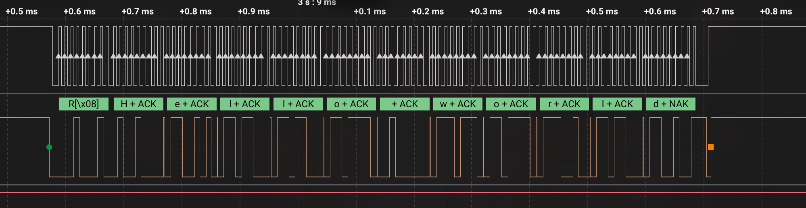
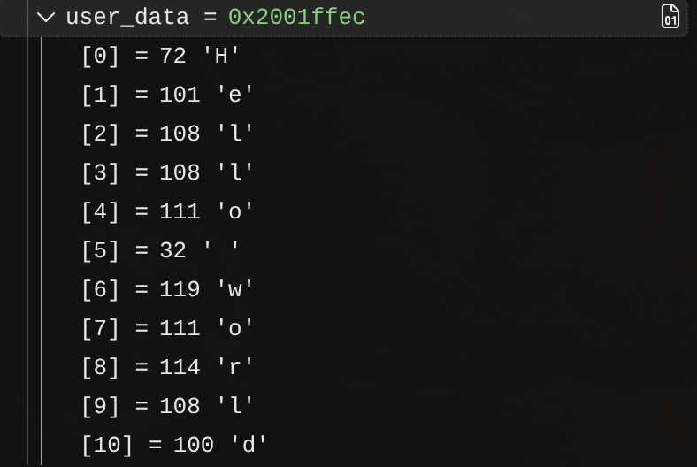

# ESP32(slave) to STM32(master) by I2C receive with interrupts

В данном примере было реализовано получение данных через прерывания при помощи драйвера I2C от STM32 к ESP32.

---
## Tests:
Из логического анализатора:

Из ST-Link debugger:
