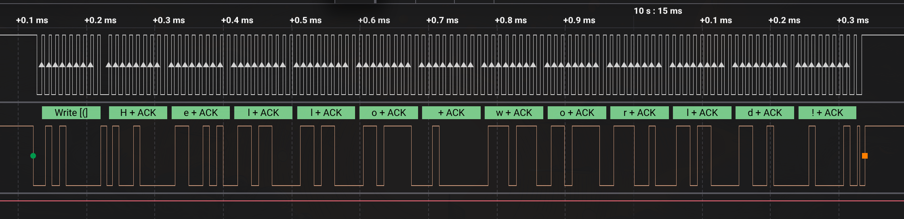
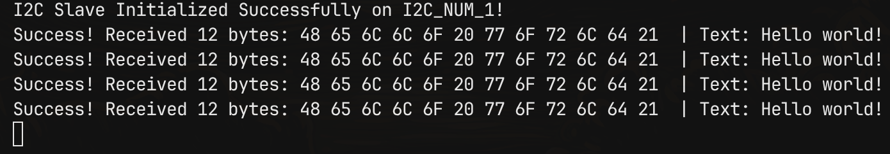

# STM32 to ESP32 by I2C transceive

В данном примере была реализована передача при помощи драйвера данных через I2C от STM32 к ESP32.

---
## Tests:
Из логического анализатора

Из serial monitor ESP32:
