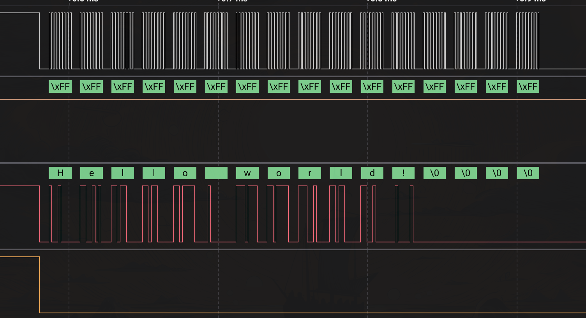

# STM32 receives from ESP32

В этом примере происходит тестирование и демонстрация функции получения данных STM32 по SPI от ESP32.

---

## Tests:
ESP32 Отправляет фразу "Hello world!", после чего STM32 получает
в свой буффер эту фразу.

Также предоставлен скриншот из логического анализатора:

