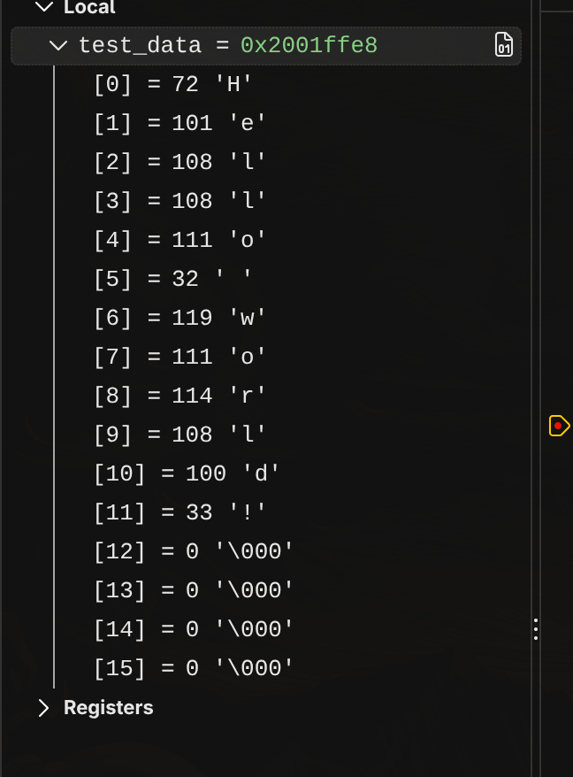

# STM receives from ESP //TODO

//Нужно пофиксить чтение мусорных байтов и скорость

Пруфы работы:
ESP32 Отправляет фразу "Hello world!", после чего STM32 получает
в свой буффер эту фразу.

Также предоставлен скриншот из логического анализатора:

