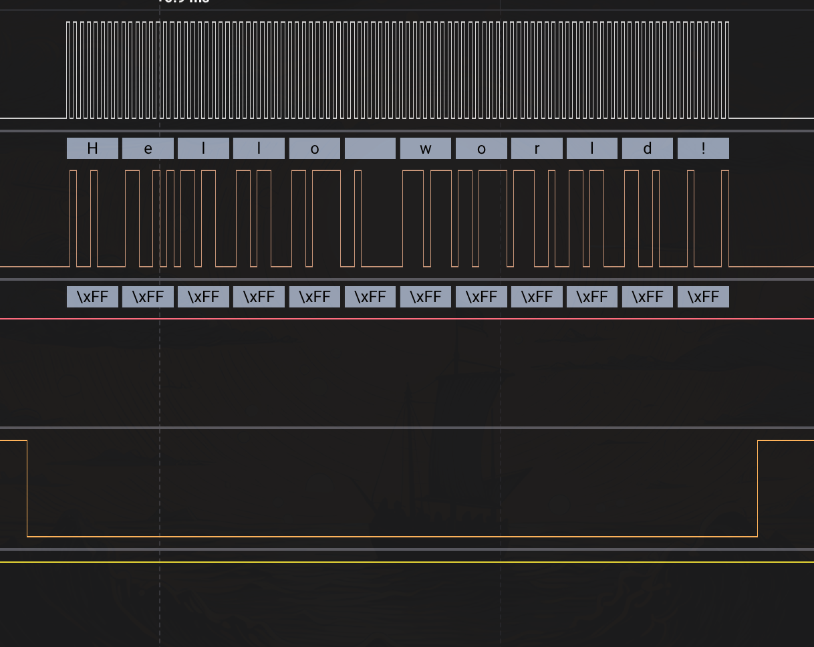

# SPI Tx/Rx test function:

## Tx function:
Код реализации и тестирования данной функции представлен в файле [spi_esp_tx_test](spi_esp_tx_test.c)

В логическом анализаторе это выглядит вот так:

## Rx function:

//TODO