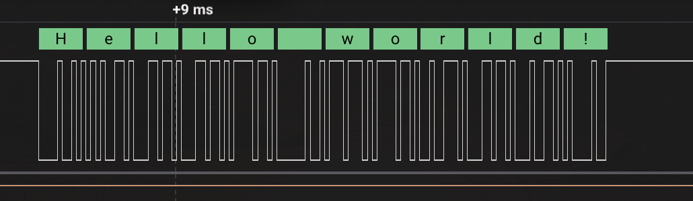
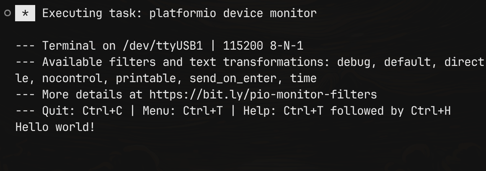

# STM32(Master) to ESP32 by USART 

В данном примере было реализована отправка данных при помощи драйвера USART от STM32 к ESP32.

---
## Tests:
Из логического анализатора:

Из Serial monitor ESP32:
