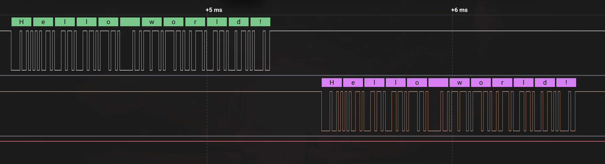
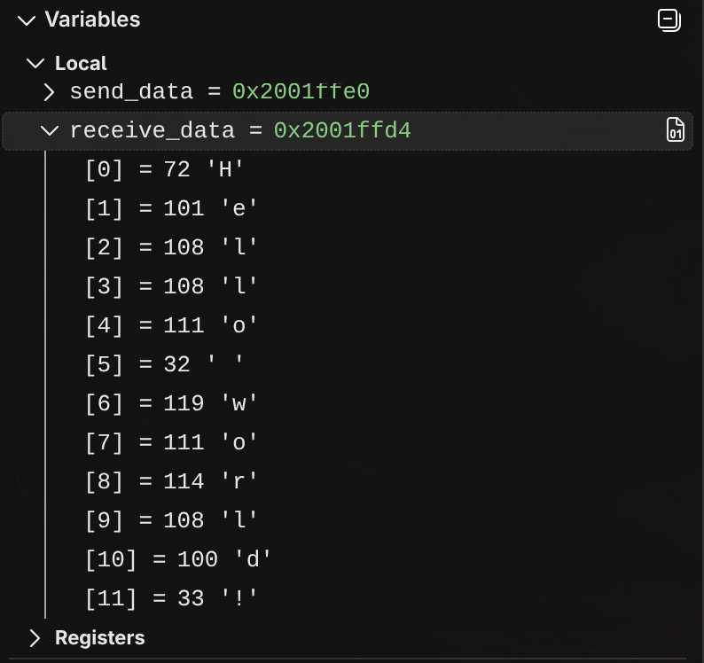

# STM32(Master) to ESP32 ECHO by USART with interrupts

В данном примере было реализована отправка и приём данных при помощи драйвера USART от STM32 к ESP32 при помощи прерываний.

---
## Tests:
Из логического анализатора:

Из ST-Link debugger:
